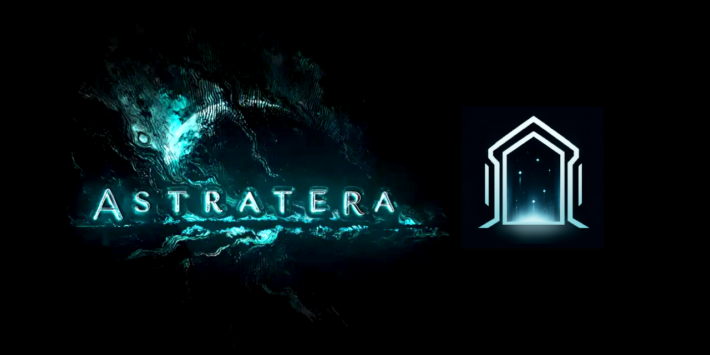
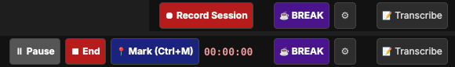
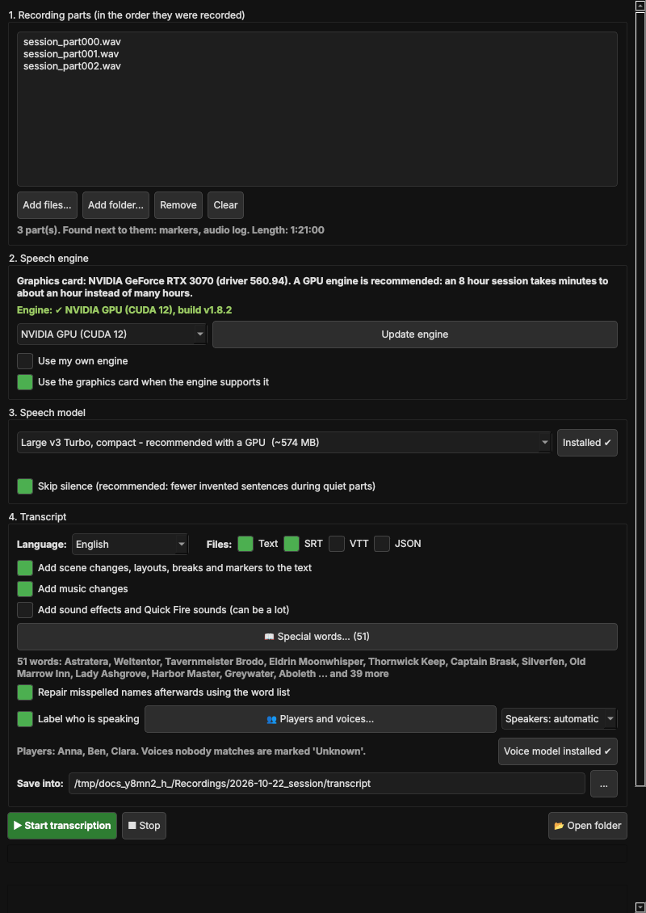
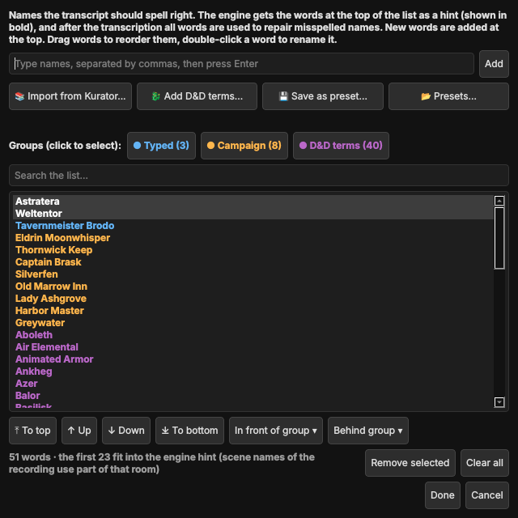
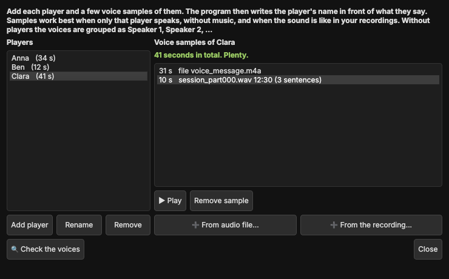
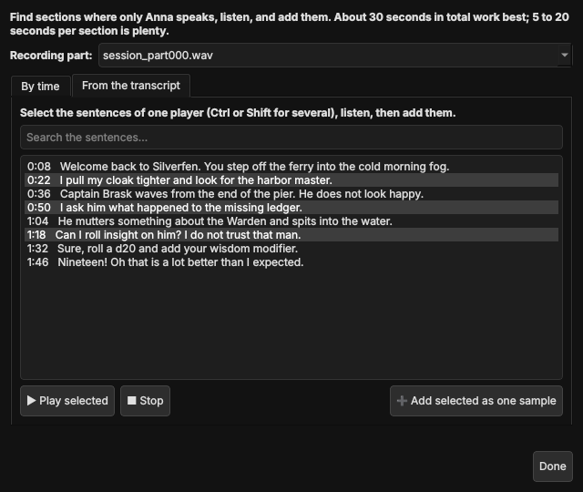

<p align="center"></p>

# Astratera Weltentor

**Astratera Weltentor: one click per scene.**
Each scene bundles music, ambient SFX, concept art and light scenes. 
Hit START ALL and the whole table changes mood. 
Includes a session recorder with scene markers, a break mode, and a small demo project to try right away.

The tool is free and open source, so enjoy and happy DM'ing.


**[⬇️ Download for Windows](../../releases/latest)** (no installation, just unzip and start)


Full Documentation: 
https://app.notion.com/p/Astratera-Weltentor-Guide-401dbb69c39281da9587e72a966c0c0a

## Run the whole table from one window

Every scene remembers its own **music, ambience, pictures, layouts, volumes and light scripts**.
Press **START ALL** and the tavern fades in, the rain starts, the lights turn warm and the right track begins to play.
No more alt-tabbing between five programs while your players wait.

<details>
<summary><b>A quick tour of the main window</b> (click to open)</summary>


| # | Where | What it does |
|---|---|---|
| 1 | Top bar | Choose your **sessions folder** with *Browse…*. 🧳 makes an older project portable. *Mini Controls* opens the small window. |
| 2 | Record and break bar | **☕ BREAK**, **⏺ Record Session**, pause, end and **📍 Mark** (these three appear while recording), and **📝 Transcribe** |
| 3 | Sessions and scenes | Your campaign. **+** makes a new session or scene. |
| 4 | Music | Scene folder, genre library or playlist, waveform and the Reorder / Filter / Playlist window |
| 5 | SFX and Quick Fire | Looping sounds, plus one-shot sounds on a **FIRE** button |
| 6 | Visuals | Pictures and videos for this scene. Double-click to put one on the stage. |
| 7 | Layouts | Saved arrangements of visuals. Double-click to fade to one. |
| 8 | DM preview | Your stage. Drag and scale things here. The green box is what the players see. |
| 9 | Management | Save the current layout, move things to the front or back, and the **Ghost** (see-through) slider |
| 10 | Audio mixer | Play, stop, previous, next, shuffle and the two volume sliders |
| 11 | Projector | Open the projector, freeze it, reload folders |
| 12 | Scripts | Saved light or web scripts for this scene |
| 13 | START ALL | Layout, script, music and SFX in one go |
| 14 | Foldable menus | **Annotate** (brush, rectangle, clear) and **Blanking** (black boxes). Click to open or close, the tool remembers. |

</details>

---

## 🖼️ Show your players the world

Build a stage out of **pictures and videos**: drag them around, scale them, fade between layouts, and show the result full screen
on your second screen or projector. Your own **DM preview** shows exactly what your players see (the green box), so you always
know what is on the table.

Save an arrangement as a **layout** and fade back to it with a double-click. Need a surprise ready? **Freeze the projector**:
your players keep seeing the calm tavern while you set up the ambush in the preview.

<table>
<tr>
<td width="50%"><br><sub>Quick Add Visual: put a picture on the stage</sub></td>
<td width="50%"><br><sub>Save the current arrangement as a layout</sub></td>
</tr>
</table>

## ✏️ Draw on it, hide the secrets

A **brush** and a **rectangle** let you circle the clue or mark where the party stands, right on the stage.
**Blanking** puts black boxes over the parts of a map your players are not supposed to see yet. It is off by default, and you can
switch it on for one scene or for all of them. Both live in small foldable menus, so they stay out of your way.


## 🎵 The right music, every time

Play from the scene's own folder, from a **genre library** (nested folders work), or from a **playlist** you built.
Shuffle it, reorder it, **blacklist** the track you are tired of, and look at the waveform before you play it.

<table>
<tr>
<td width="50%"><br><sub>Reorder, blacklist or whitelist tracks</sub></td>
<td width="50%"><br><sub>Build playlists from your genre library</sub></td>
</tr>
</table>

## 💥 Thunder on cue

Loop **ambience** like rain, a crowd or a ship's creak, and keep a row of **one-shot sounds** ready on **Quick Fire**
(open it with **Shift+S**). A door slam, a dragon's roar, a crack of thunder at the perfect moment, one click each.


## ☕ Break time and 🗔 mini controls

Need a bathroom break? One click swaps in a **break slideshow and music**, and brings your scene back exactly as it was
when the break is over. The **mini controls** are a small always-on-top window with next scene, next layout and music buttons,
so you can run the table without switching windows.


## ⏺ Record the session, and never lose the good moments

Record the table audio in safe **30-minute chunks**, so a crash costs you minutes, not the whole evening.
Press **Ctrl+M** to drop a 📍 mark whenever something great happens ("Grimble reveals the secret!").
Scene changes, layouts and breaks are marked for you, and the app also keeps a log of what music and sounds played when.

<table>
<tr>
<td width="55%"><br><sub>Pause, End, Mark and the timer appear while you record</sub></td>
<td width="45%"><br><sub>Pick a name, a folder and your microphone</sub></td>
</tr>
</table>

## 📝 Turn the recording into your session notes

Press **Transcribe** and get your whole session as text, ready for recaps, campaign notes or that one quote nobody remembers right.
It runs **on your own PC**, nothing is uploaded, and with a mid-range NVIDIA graphics card a three-hour session takes roughly 15 to 45 minutes.

* **Names come out right.** Give it a **special words** list (your NPCs, towns and spells) and the engine spells them the way you do.
  Import them straight from your campaign notes in **Kurator**, or add a ready-made list of D&D monsters, spells and classes.
* **It knows who is speaking.** Add your players with a few seconds of their voice, and every line starts with their name.
  Voices it does not know are still told apart as *Unknown 1*, *Unknown 2*, so you can follow who said what.
* **Your scenes are in the text.** Scene changes, layouts, breaks and your 📍 marks can be woven in between the sentences, and music changes too if you like.

<table>
<tr>
<td width="50%" valign="top"><br><sub>Pick the recording, the engine and the model, then press Start</sub></td>
<td width="50%" valign="top">
<br><sub>Special words keep names spelled right, grouped by where they came from</sub><br><br>
<br><sub>Add players and voice samples so the text says who speaks</sub>
</td>
</tr>
</table>



*The tip for a good start:* run your first session without names, pick a few clean lines of each player right from the transcript,
and run it again. The second run takes seconds, because the listening is not repeated.
The full walkthrough is in [Transcribing your session](docs/guide/14-transcription.md).

## 💡 Let the lights play along

Build **light scenes** in the Light Designer and attach them to a scene. When the scene starts, the app sends them to your
smart lights, so the dungeon really goes dark when the torches die. Under the hood these are simple saved **web requests**,
so you can also trigger other smart things.

<!-- TODO: add the Light Designer screenshot here once it exists:
 -->

## 🧳 Take it with you

Everything is saved with **relative paths**, so you can copy your sessions folder to another PC (or a USB stick) and it just works.
And if you want other tools to talk to the app, there is a small **remote control** interface, see [docs/REMOTE_API.md](docs/REMOTE_API.md).

---

## Documentation

* A friendly **panel-by-panel guide** lives in [`docs/guide/`](docs/guide/README.md).
* Turning recordings into text: [Transcribing your session](docs/guide/14-transcription.md).
* Remote control for other tools: [docs/REMOTE_API.md](docs/REMOTE_API.md).

## Download (no Python needed)

1. Open the **[Releases](../../releases)** page and download `Astratera-Weltentor.zip`
   (or the latest run under *Actions → Build portable Windows version → Artifacts*).
2. Unzip anywhere (USB stick works) and run `Astratera-Weltentor.exe`. The first start can take a few seconds.
   VLC is bundled – nothing to install.
3. Windows SmartScreen / antivirus may warn about an unsigned PyInstaller exe: *More info → Run anyway*.

## Try the demo project

This repo (and the separate `Astratera-Weltentor-sample-project.zip` on the Releases page) contains `sample_project/` and
`sample_libraries/`: a small sci-fi demo with scenes, layouts, music and sound effects.

1. Top bar → **📁 Browse…** → pick the `sample_project` folder (the folder that *contains* the session folders).
2. Click *Demo Session* → *010_Market*: layouts, music, SFX and a playlist are ready.
   *020_Softlight Botanics* and *030_Forgarm* are two more scenes.
3. Optional libraries: in the **Music** panel untick *Use Music from Folder*, set the path field to
   `sample_libraries/music` (genres `Ambient`, `Combat`), same for SFX with `sample_libraries/sfx`.
   The *Perfect Playlist* of the market scene uses tracks from that library.
4. Right-click any item → **🔗 Link to…** to spread it to other scenes.

> The demo music was generated with Suno and the demo pictures with Midjourney. They are included only so you can try the
> tool. They are **not** covered by the MIT license, so please don't reuse them elsewhere.

## Run from source

```bash
python -m venv .venv && .venv\Scripts\activate        # Windows
pip install -r requirements.txt
python main.py
```
Transcription works from source too. The speaker labels need the voice component `sherpa-onnx`, which is listed in `requirements.txt`
(the transcribe window also offers to install it). The speech engine and the models are downloaded from inside the app on first use.

From source, VLC is picked up from a `vlc` folder next to `main.py` (run `python tools/fetch_vlc.py` to create `vlc_bundle`, rename it to `vlc`) or from a normal 64-bit VLC install.

## Folder layout & portability

```
<Sessions folder>                (chosen with the Browse button)
└── <Session>
    └── <Scene>
        ├── music/  sfx/  visuals/  layouts/  scripts/  quickfire/  playlists/
        └── scene_settings.json
```
* Everything the app saves into a project (scene settings, layouts, playlists) uses **relative paths**
  (`{ROOT}/Session/Scene/visuals/x.png`, `{MUSIC}/Jazz/a.mp3`, `{SFX}/…`, `{VISUALS}/…`).
  Copy the sessions folder to another PC, press *Browse…* to select it there, done.
* Library paths (music / sfx / visuals libraries) are machine settings and live in `director_config.json`
  next to the program; set them once per PC. Files from libraries are stored as `{MUSIC}/…` etc.
* Files **outside** the sessions folder and the libraries keep their full path and won't travel.
  The **🧳** button next to *Browse…* rewrites an older project to the portable format (it makes a backup first)
  and lists everything that points outside the project.

## Remote control

External tools can drive the app (scenes, layouts, music, genre tracks, playlists, SFX, quick-fire) by writing
`director_remote_command.json` next to the program. See [docs/REMOTE_API.md](docs/REMOTE_API.md).

## Building the exe yourself (GitHub Actions)

* Publish a Release on GitHub (any tag name, e.g. `v1.0.0`) → the workflow builds the Windows version and attaches the zips to that Release.
* Or: *Actions → Build portable Windows version → Run workflow*. It builds a single exe; untick *onefile* for a folder build that starts faster.
* Local build: `build_windows.bat` (see the comments inside).
* Optional: `python tools/make_sample_project.py` creates a small synthesized demo (generated tones and gradients) in `synthetic_demo/`.

## Files the app creates (ignored by git)

`director_config.json` (your paths), `crash.log`, `director_remote_command.json`, `portable_backup_*`, and `transcription/`
(the downloaded speech engine and models, the voice model, and your players with their voice samples).

## License

The source code of Astratera-Weltentor is MIT – see [LICENSE](LICENSE). The demo content is explained under
*Try the demo project* above.

The Windows download bundles third-party software that keeps its own licenses. Because it includes PyQt6 (GPL-3.0),
the bundled Windows binaries are distributed under the terms of the GPL-3.0. VLC / libVLC, ffmpeg and others are
LGPL/GPL as well. See [THIRD_PARTY_NOTICES.md](THIRD_PARTY_NOTICES.md) for the full list and where to get the source.

The **transcription** feature downloads these on first use. They keep their own licenses: whisper.cpp and the OpenAI Whisper models (MIT),
the Silero voice-activity model (MIT), sherpa-onnx (Apache-2.0) and the NVIDIA NeMo TitaNet speaker model (CC-BY-4.0).
The built-in English D&D term list uses names from the System Reference Document 5.1 by Wizards of the Coast LLC, available under the
[Creative Commons Attribution 4.0 license](https://creativecommons.org/licenses/by/4.0/legalcode).

*Astratera Weltentor is an unofficial, fan-made tool. It is not affiliated with or endorsed by Wizards of the Coast.
Dungeons & Dragons and D&D are trademarks of Wizards of the Coast LLC.*
