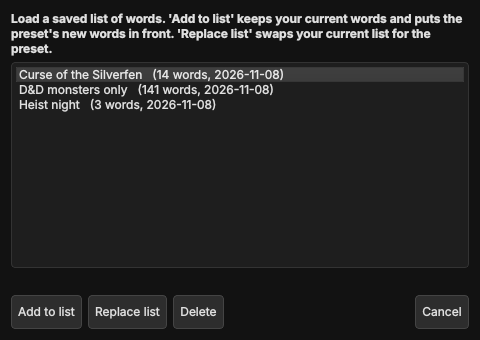

# Transcribing your session

Turn the recording into text, **on your own PC**. Nothing is uploaded anywhere. The transcript can show who said what,
spells your NPC and place names the way you wrote them, and weaves your scene changes and bookmarks into the text.

You need a finished recording first, see [Recording your session](08-recording.md).


## Open it

Press **📝 Transcribe** in the top bar. You can't open it while a recording is running, because both would fight for the PC's power.
Transcribe after the session.

The window has four numbered steps. Work from top to bottom. The tool remembers your choices for next time.

## 1. Pick the recording

Press **Add files…** and pick the `session_part000.wav`, `session_part001.wav`, … files of your session,
or **Add folder…** to take them all at once. You can also add normal audio files (`mp3`, `m4a`, `flac`, `ogg`, `mp4` and more).
Drag the entries to change the order.

If `session_markers.json` and `session_audio_log.json` lie next to the files, the tool finds them and tells you.
Those are what puts scene changes, layouts, breaks and music into the text.

## 2. The engine

The "engine" is the program that does the listening (**whisper.cpp**, free and open source).

* Pick the type that fits your PC and press **Download engine** (one time):
  * **NVIDIA GPU (CUDA 12)** is the best choice for a GeForce card. A mid-range card transcribes **4 to 12 times faster than real time**:
    a 3-hour session in roughly 15 to 45 minutes.
  * **NVIDIA GPU (CUDA 11)** is for older drivers.
  * **CPU only** works everywhere but is slow for long sessions.
* The line above the buttons tells you which graphics card was found.
* **Use my own engine** lets you point to a `whisper-cli` you built yourself, for example a Vulkan build for AMD or Intel graphics.
* **Update engine** appears once an engine is installed, in case a newer one is out.

## 3. The model

The model is the "brain". Bigger is more accurate but slower. The list tells you what each one is good for:

| Model | When to use it |
|---|---|
| **Large v3 Turbo, compact** | Recommended with a graphics card. Very good, about 570 MB. |
| **Small** | Recommended without a graphics card. |
| **Large v3** | The most accurate and the slowest. |
| Medium, Base, Tiny | In between, or only for quick tests. |

Press **Download** (one time). **Skip silence** is on by default. It stops the engine from inventing sentences during quiet parts.

## 4. The transcript

* **Language:** choose the language you play in, or let the tool detect it.
* **Files:** *Text* is for reading. *SRT* and *VTT* are subtitle files with timecodes. *JSON* is for other programs.
* **Add scene changes, layouts, breaks and markers to the text:** your recording markers appear as lines between the sentences.
* **Add music changes** and **Add sound effects…** do the same for the audio log. Sound effects can be a lot.
* **Save into:** the folder for the results. The default is a `transcript` folder next to your recording.

Then press **▶ Start transcription**. **■ Stop** cancels. **📂 Open folder** shows the results.

### An example result

```
Transcript: 2026-10-22_session
Length: 3:12:40

--- 00:00:00  Scene: Silverfen Harbor ---
[00:00:08] Dungeon Master: Welcome back to Silverfen. You step off the ferry into the cold morning fog.
[00:00:22] Anna: I pull my cloak tighter and look for the harbor master.
[00:00:50] Ben: I ask him what happened to the missing ledger.
--- 00:01:12  Marker: Brask reveals the secret ---
[00:01:18] Unknown 1: Can I roll insight on him?
```

---

## Special words: names that come out right

A speech engine doesn't know *Thornwick Keep* or *Lady Ashgrove*. Without help it writes something that sounds similar.
The **📖 Special words…** list fixes that in two ways:

1. The **first words** of the list (about 300 letters worth) are given to the engine as a hint *before* it listens.
2. **After** the transcription the tool compares the text with your whole list and **repairs misspelled names**
   (switch this off with *Repair misspelled names afterwards using the word list*).
   It is careful: ordinary words are never changed into names.


### Reading the list

The list is sorted **by importance**: the further up, the more likely the word reaches the hint. Words that reach it are **bold**.
Every word has a colour that shows where it came from:

| Colour | Group | Comes from |
|---|---|---|
| 🔵 Blue | **Typed** | Words you typed |
| 🟠 Orange | **Campaign** | Names imported from your campaign notes (see below) |
| 🟣 Purple | **D&D** | The built-in D&D terms |

The little chips above the list count each group. Click one to select the whole group.

### Working with the list

* **Add:** type a word (or several, separated by commas) and press **Enter** or **Add**. New words go to the **top**.
* **Rename:** **double-click** a word, type, press Enter.
  A word must have at least 2 letters, and you can't create a duplicate.
* **Reorder:** drag words with the mouse, or use the buttons **To top**, **Up**, **Down**, **To bottom**.
* **In front of group ▾** and **Behind group ▾** move the selected words to the start or the end of a colour group.
  Handy when you want your campaign names to sit in front of the D&D terms.
* **Remove:** select words and press **Remove selected**. **Clear all** empties the list.
* **Search:** the search box finds a word. While a search is active, reordering is switched off so nothing lands in a wrong place.

The list is happy with **hundreds of words**. Selecting all 500 D&D terms and moving them is instant.

### Presets



**💾 Save as preset…** stores the current list under a name, for example one per campaign.
**📂 Presets…** loads one again: **Add to list** puts its words in front of your current list, **Replace list** swaps your list for the preset.

### Import names from your campaign notes (Kurator)

If you keep your campaign in **Kurator**, **📚 Import from Kurator…** reads your locations, NPCs, quests and groups directly.


1. Step 1: choose the `campaign-data` folder of your Kurator session manager, then the campaign(s) you want.
2. Step 2: tick the categories and names you want. Use **Tick highlighted** to tick many lines at once.
3. Two helpers clean the names for you: *Split "Name, Alias" and "Name (Alias)" into separate words* and
   *Remove codes like "A3 -" and numbering like "01"*.

### Built-in D&D terms


**🐉 Add D&D terms…** adds spells, monsters, classes, items and more, in **English** or **German**. Tick the categories you want.
They come in the purple group, behind your own words. Add only what you need, a few hundred words are fine.

> The English terms are taken from the System Reference Document 5.1 by Wizards of the Coast, under the
> Creative Commons Attribution 4.0 license, see the [README](../../README.md#license).

---

## Who is speaking?

Switch on **Label who is speaking**. The tool then writes the speaker in front of every sentence.
It works from the **voice**, so it doesn't matter that you recorded on a single track.

It needs a small extra: the **voice model** (40 MB, one time).
Press **Download voice model**. When it says **Voice model installed ✔** you are done.
If you run the tool from source and the line asks for the *voice component*, press the **Install voice component** button once.

### Without players: Speaker 1, Speaker 2, …

If you don't set up players, the voices are simply grouped as **Speaker 1**, **Speaker 2**, and so on.
If you know how many people were at the table, pick that number in **Speakers: automatic** to make it more exact.

### With players: names

Press **👥 Players and voices…** and add each player.


1. **Add player** and type a name. Add the Dungeon Master as a player too, if you want their lines labelled.
2. Select the player, then add **voice samples**, about **30 seconds in total** is plenty:
   * **From audio file…** takes a short voice message or any recording of that person.
   * **From the recording…** lets you pick a moment from your session.
3. **Check the voices** compares all players with each other and warns you when two voices sound too alike.

Good samples have **only that one person speaking**, no music, and the same microphone situation as at the table.


**From the recording** has two tabs. **By time** lets you type a start and end time.
**From the transcript** shows the sentences of a part you already transcribed: select the ones that are clearly Anna,
press **Play selected** to check, and **Add selected as one sample**. That's the fast way after your first session:
run it once without names, pick a few clean lines per player, and run it again.

### "Unknown 1", "Unknown 2"

When a voice matches **no** player, the tool doesn't just write "Unknown". It **tells the unknown voices apart** and numbers them:
**Unknown 1**, **Unknown 2**, … So you still see **when the speaker changes**, even if you don't know who it is.
A guest at the table, someone who only appears once, or a player without samples shows up this way.
Add samples for them later and the numbers turn into a name.

This costs next to nothing: the voice prints already exist, so the grouping takes well under a second for a whole session.
A plain **Unknown** (without a number) is only used for passages that are too short or too noisy to judge.

### Run it again in seconds

The tool keeps its working files in a `_work` folder inside your results folder. If you change the players, the word list
or the speaker count and press **Start** again, the **listening is not repeated**. Only spelling repair and labelling run again, which takes
seconds. Delete the `_work` folder to force a full new run.

---

## Where do the files live?

Next to the program, in a `transcription` folder:

```
transcription/
├── engine/      the downloaded engine
├── models/      the downloaded models
└── speakers/    the voice model, and players/ with the names and their voice samples
```

Your results go to the folder you picked under **Save into**.
You can delete a model you no longer use and download it again later.

## Good to know

* **Nobody listens along.** Everything runs on your PC, including the voice labels.
* Whisper sometimes **invents words** in very quiet parts, or mishears fast talking.
  Skim the text once before you share it. That's normal for every speech engine.
* **Crosstalk** (several people at once) is the hardest case. The label then follows the louder voice.
* A **very short** sentence ("Yes!", "No.") gets the label of the people around it, because a voice can't be judged from half a second.
* If the file path has special characters (like `ä` or `é`), the tool works around that for you.

## Problems?

**"Download engine" fails.** Check your internet connection and try again. Some virus scanners block the download. Allow it,
or choose *Use my own engine*.

**It is very slow.** Look at the graphics card line. If it says no NVIDIA card was found, pick a smaller model such as *Small*.

**Names are still wrong.** Move them **to the top** of the special words, so they reach the hint. Repair only changes words that clearly
look like a word from your list, so a very different spelling needs an extra entry.

**Everyone is "Speaker 1".** Voices that sound similar are grouped. Try a fixed number in **Speakers**, or add players with good samples.

**A player is mixed up with another.** Use **Check the voices** in the players window and replace the samples of the two players with cleaner ones.

**The voice component can't be installed.** The Windows download already includes it. When you run from source, run
`pip install sherpa-onnx`.
